<h1 align="center">👋 Hi, I'm Heritiana Rasamoelina</h1>

  

  
  
  
  

---

### 🧠 About Me

- 💼 Full-stack developer, currently employed full-time.
- 🏫 Student at **42 Antananarivo** (C/C++ and system programming).
- 🤖 I use AI daily to work faster and keep improving. I read, understand and own what I ship.
- 🤝 Open to tech discussions and collaboration.

---

### 🚀 Featured Projects

- 🎓 **[MyScholaria](https://github.com/hrasamoe/myscholaria)** — School management system (`TypeScript`, `React`, `MUI`, `Node` `Supabase`)
- 🔒 **Private full-stack project** — Production architecture

---

### 🛠️ Tech Stack

---

### 📊 Stats & Activity

  
  

  

---

### 🐍 Contribution Snake

  <picture>
    <source media="(prefers-color-scheme: dark)" srcset="https://raw.githubusercontent.com/hrasamoe/hrasamoe/output/github-contribution-grid-snake-dark.svg" />
    
  </picture>

